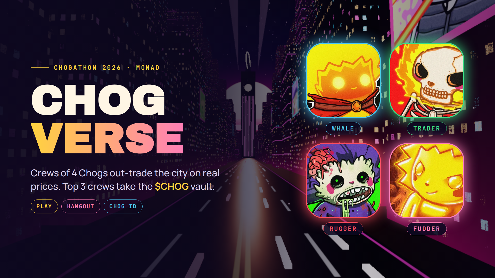

# Chog Verse

**Team up with three other Chogs, out-trade every crew in the city, and get the $CHOG out of the vault in the bank. The vault opens every 7 days.**

Built for [Chogathon 2026](https://chogathon.chog.xyz/).

| | Link |
|---|---|
| Demo (play solo, guest pass, bots fill your crew, 30-min game days) | https://chog-verse-demo.vercel.app |
| Testnet (the real game, wallet login, entry paid on Monad testnet) | https://chog-verse.vercel.app |



## Three doors

The hub at `/` opens onto three parts of the city:

- **Play** (`/play`): the crew game for the $CHOG vault (below).
- **Hangout** (`/hangout`): public rooms, group chats and DMs, with your Chog as the speaker, plus who's online.
- **Chog ID** (`/id/<n>`): a foil card for any of the 1,969 Chogs with tier, trait rarity, rarity rank and game stats. Download it as a PNG, post it on X or share the link (the link previews the card).

## Try it

**No wallet needed:** open the [demo](https://chog-verse-demo.vercel.app).

1. Click **Play**, then grab a **Guest pass** and pick any Chog.
2. Start a crew. Bots fill the other 3 seats.
3. Days are 30 minutes: pick, watch it lock, and see your score on the Leaderboard.
4. Then open **Hangout** and **Chog ID**.

**Real game:** open the [testnet site](https://chog-verse.vercel.app).

1. Connect a wallet and sign in.
2. Get MON from https://faucet.monad.xyz.
3. Claim test $CHOG in the app and pay the 100 test $CHOG entry.
4. A crew needs 4 real players.

## How the game works

- **Crews of 4 Chogs** race through a 7-day season. Each Chog takes one role:
  - **Whale**: splits the crew's $10k between the picks and cash.
  - **Trader**: picks the token to pump.
  - **Rugger**: picks the token to crash.
  - **FUDder**: bets $1k against a rival crew's public pick.
- **Every day (UTC):** picks until 14:00, picks go public at 14:00 (Whale and FUDder act), everything locks at 15:00, scored 24 hours later on real prices.
- **Tokens:** the top 20 nad.fun tokens by market cap, with live prices.
- **The vault:** each Chog pays 100 $CHOG into the ChogBank. When the vault opens, the top 3 crews split it 50/30/15, paid on-chain automatically. 5% rolls into the next season.
- **Your Chog is your player:** pick any of the 1,969 Chog Genesis NFTs.

## Tech

- Next.js 16 (App Router), React 19, Tailwind 4, Motion, Three.js (the neon city)
- Postgres via Drizzle (Neon in production, embedded PGlite locally)
- wagmi + viem on Monad: wallet-signature login, Chog ownership on mainnet, entry and payout on testnet
- Foundry contracts: `contracts/` (ChogBank, TestChog)
- `next/og` for the Chog ID card images
- Vercel (two deploys of one codebase: `NEXT_PUBLIC_MODE=demo|live`) + Vercel Cron for the game engine

## Run locally

```shell
pnpm install
cp .env.example .env.local   # demo mode works with no database URL
pnpm dev -p 3001
```

Open http://localhost:3001.

## Onchain

- Chog Genesis NFT (Monad mainnet): `0xc96d31F8626c6D03Fae5dCD3d61e3FB9F4a73763`
- ChogBank (Monad testnet): `0xe77Ec2184cbb338FCdB1D0C1B985c6F28FAB9C9A`
- TestChog, test $CHOG (Monad testnet): `0x6b9C05ff1dDA77454D3C5F2A0136D2BE71b2fFc9`
